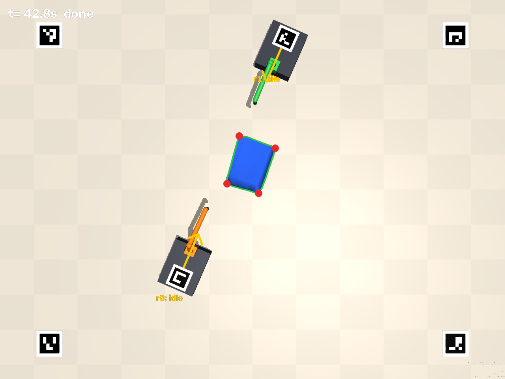
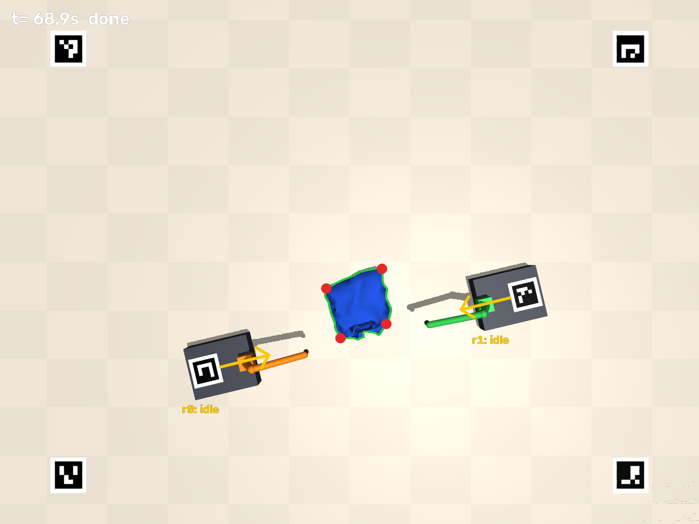
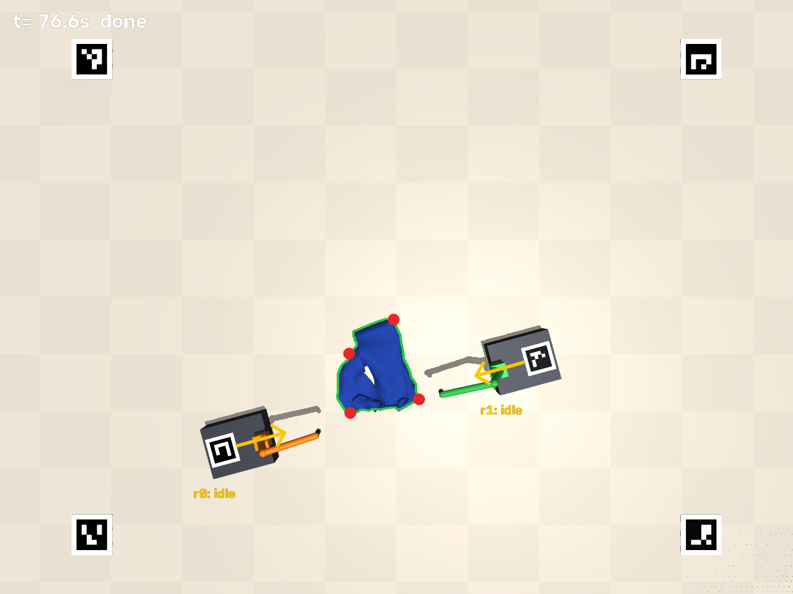

# laundry-bot

Simulated "arms on wheels" that fold laundry, guided by one ceiling camera.

  

Two mobile robots and a towel on the floor. The ceiling camera locates
everything; a director program plans the fold and steers every robot in a
closed loop. It folds a towel in half twice, a T-shirt with the standard
retail fold (left side in, right side in, hem to collar), and trousers (leg
over leg, hems to waist, in half again).

## Run it

```bash
python3 -m venv .venv && . .venv/bin/activate
pip install -r requirements.txt
python scripts/run_fold_demo.py                   # towel, ~5 min, writes output/fold_demo_towel.mp4
python scripts/run_fold_demo.py --garment shirt   # T-shirt, ~10 min
python scripts/run_fold_demo.py --garment pants   # trousers, ~10 min
python scripts/run_fold_demo.py --fast       # no cloth self-collision, ~3x faster
python scripts/run_fold_demo.py --seed 4     # different towel pose / wheel slip
python -m pytest tests
```

On a headless Linux machine you need an OpenGL backend, e.g.
`sudo apt install libosmesa6` (MuJoCo then renders with `MUJOCO_GL=osmesa`, the default here).

## How it is organised

```
laundrybot/
  interfaces.py   Camera + RobotDriver: the only things the brain talks to
  director.py     the brain: perception loop, fold planning, path planning, motion
  perception.py   camera self-calibration, robot tracking, towel detection (OpenCV)
  kinematics.py   arm inverse kinematics
  geometry.py     robot dimensions (shared by sim and brain)
  viz.py          draws the brain's beliefs over the camera image
  sim/garments.py towel, T-shirt and trousers cloth meshes
  sim/scene.py    builds the MuJoCo world (cloth, robots, markers, cameras)
  sim/world.py    simulated Camera + RobotDriver (with wheel slip)
scripts/run_fold_demo.py
tests/
```

**The key design rule:** `director.py` never reads simulator state. It only gets
camera images and sends velocity / joint / gripper commands through
`interfaces.py`. To run on hardware you write a `RobotDriver` for a real robot
(e.g. LeKiwi base + SO-101 arm via Hugging Face LeRobot) and a `Camera` for a
real webcam; the director stays the same.

### What happens in a fold

1. **Calibrate:** solve the camera's pose from 4 ArUco markers on the floor
   (0.15 px reprojection error). No measuring where the camera hangs.
2. **Track:** each robot has a marker on its back; position ~1 mm, heading ~0.4°.
3. **See the towel:** colour segmentation, then its outline and four corners.
4. **Plan:** fold across the long side, toward the middle of the room (keeps
   everything in camera view). One robot per side, each takes one corner.
5. **Drive:** shortest path around the towel, closed-loop on the camera. The
   simulated wheels slip ±8% and drift sideways, so driving blind would miss.
6. **Grasp:** turn to face the corner, lower, pinch, lift; check the gripper
   is actually holding.
7. **Fold:** both robots drive in lock-step while lifting the edge in an arc,
   fine-position, lower, release, back off. On a failed grasp, let go and re-plan.
8. Repeat.

Every fold is the same primitive: *grab these points, lay them there*. A
planner turns what the camera sees into those points; `plan_fold` then works
out where each robot must stand so its base stays off the cloth while it
carries, and which robot takes which point.

### The shirt

The shirt can lie in any orientation, so the director first works out its own
frame from the silhouette: the shape's principal axes, the one the outline is
mirror-symmetric about, and the wider end (sleeves) = collar. Then it finds
sleeve tips and hem corners (within ~1.5 cm in tests). The fold lines sit far
enough from the centre that each folded sleeve stays inside the opposite fold
line, so the second side folds cleanly over the first.

### The pants

Same silhouette trick, but "which end is the top" needs a different rule:
trousers with splayed legs are *widest at the hems*, so instead the waist is
the end where the centre line runs through fabric (the other end has the gap
between the legs). Fold 1 grabs the left waist corner and left outer hem and
mirrors them across the centre line; folds 2 and 3 grab the two bottom
corners and lay them on the top edge.

### Staying in view

The floor markers also mark out the robots' work area: robots never plan to
leave it, and back-offs are shortened near its edge. If the camera loses a
robot anyway, it creeps back toward the middle on its last known heading;
after 8 s the fold aborts with an error instead of hanging.

## Honest limitations (what's simplified)

| Simplification | Reality | Plan |
|---|---|---|
| "Magic pinch" gripper: closing grabs the fabric (all stacked layers) under the fingertip | Pinching thin fabric off a surface is the hardest physical bit | Prototype gripper on real hardware early; learn grasping from teleoperated demos |
| Shirt and pants are single flat layers | Real garments are front + back sewn together (flattened tubes) | Two-layer meshes with seams; matters most for unfolding |
| Arm lifts to 30 cm | Folding 1 m pants in half ideally lifts the hems 50 cm; the fabric drags over itself | Taller arm, or fold in thirds / drag-fold on purpose |
| Shirt keypoints from geometry rules | Wrinkles, collars, buttons break hand-written rules | Learned keypoint detector, trained on rendered shirts |
| Solid blue towel, plain floor; colour threshold finds it | Patterned clothes, on a bed, in a pile | Swap `ClothDetector` for a learned segmenter (train on synthetic renders from this sim + real photos) |
| Towel starts laid flat | Laundry arrives crumpled | Flattening / unfolding is its own (harder) task, next big milestone |
| Robots don't avoid each other; one obstacle (the towel) | Furniture, pets, each other | Proper multi-robot planner |
| Arm reaches forward only (planar, 3 pitch joints) | SO-101 also has pan + wrist roll | Add when needed; the base turning covers it for now |
| Cloth simulated as stretch-free mesh, no bending stiffness | Real fabrics vary a lot | Fine for planning; real behaviour comes from real data |
